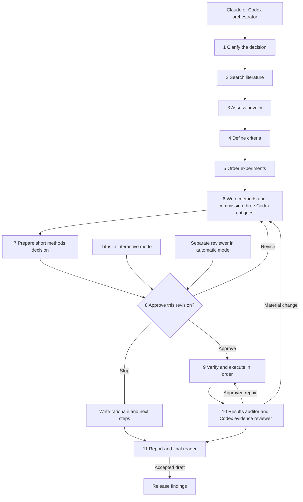
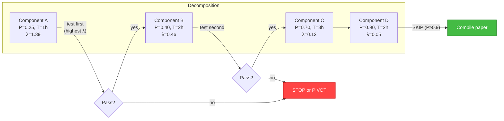

# Architecture Diagram

## Workflow overview

The hub dispatches each leaf and owns all user dialogue. The three plan reviewers see the same inputs independently. The separate automatic approver sees their disagreements. See the [workflow](WORKFLOW.md) for loop limits and the [agent inventory](ARCHITECTURE.md#agent-inventory) for responsibilities.

## Fail-Fast Lambda Ordering

